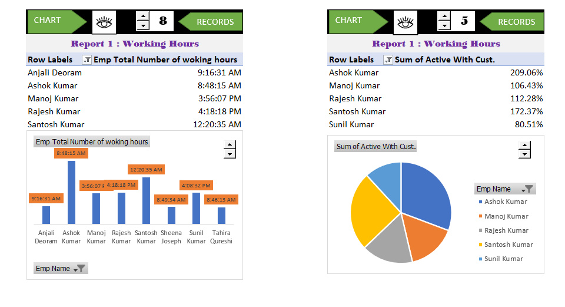

# 📊 Employee Working Hours & Performance Dashboard – Excel

An interactive **Excel Employee Performance Dashboard** designed to analyze employee working hours, work efficiency, break time, customer activity, and call performance.

## 📸 Dashboard Preview

## 📌 Project Overview

This project focuses on analyzing employee working hours and performance using Microsoft Excel.

The dashboard provides insights into employee-wise working hours and active customer handling percentages. It helps compare employee performance and understand how working time is distributed across different activities.

## 🚀 Dashboard Features

- Employee-wise Total Working Hours Analysis
- Work Efficiency Analysis
- Employee Break Time Analysis
- Active With Customer Percentage
- Employee Performance Comparison
- Call Performance Analysis
- Interactive Pivot Tables
- Pivot Charts and Data Visualization
- Employee-wise Performance Reporting

## 📊 Dashboard Components

### Dashboard 1 – Working Hours Analysis

- Employee-wise Total Working Hours
- Working Hours Comparison using Column Chart
- Employee Working Time Analysis

### Dashboard 2 – Customer Activity Analysis

- Employee-wise Active With Customer Percentage
- Customer Activity Distribution using Pie Chart
- Comparison of Employee Customer Activity

### Dashboard 3 – Employee Efficiency Analysis

- Total Working Hours
- Work Efficiency
- Efficiency Percentage
- Attended Calls
- Active Time
- Non-working Percentage

### Dashboard 4 – Break Time Analysis

- Lunch Break
- Normal Break
- Feedback Time
- Training Time
- Meeting Time
- Unwanted Break
- Total Break Taken

### Dashboard 5 – Overall Performance Analysis

- Attended Calls
- Transferred Calls
- Conferenced Calls
- Redirected Calls
- Hold Calls
- Average Duration of Calls
- Unattended Call Time

## 🛠 Tools & Technologies

- Microsoft Excel
- Pivot Tables
- Pivot Charts
- Excel Formulas
- VLOOKUP
- MID and FIND Functions
- Data Analysis
- Data Visualization
- Dashboard Development

## 💡 Skills Demonstrated

- Excel Data Analysis
- Employee Performance Analysis
- Working Hours Analysis
- Productivity Analysis
- KPI Reporting
- Pivot Table Reporting
- Interactive Dashboard Development
- Business Intelligence
- Data Visualization

## 🎯 Business Use Cases

- Employee Productivity Monitoring
- Working Hours Tracking
- Employee Efficiency Evaluation
- Break Time Monitoring
- Customer Handling Performance Analysis
- Call Centre Performance Monitoring
- Workforce Performance Reporting

## 📂 Project Files

| File | Description |
|---|---|
| `Employee_Performance_Dashboard.xlsm` | Excel Employee Performance Dashboard |
| `employee_dashboard.png` | Dashboard Screenshot |
| `README.md` | Project Documentation |

## ▶️ How to Use

1. Download the repository.
2. Open `Employee_Performance_Dashboard.xlsm` using Microsoft Excel.
3. Enable macros only if prompted and if you trust the workbook.
4. Navigate to the Dashboard worksheet.
5. Use the available Pivot Table filters to explore employee performance.
6. Review working hours, customer activity, efficiency, and break-time analysis.

## 👨‍💻 Author

Created using Microsoft Excel for employee performance and productivity analysis.
